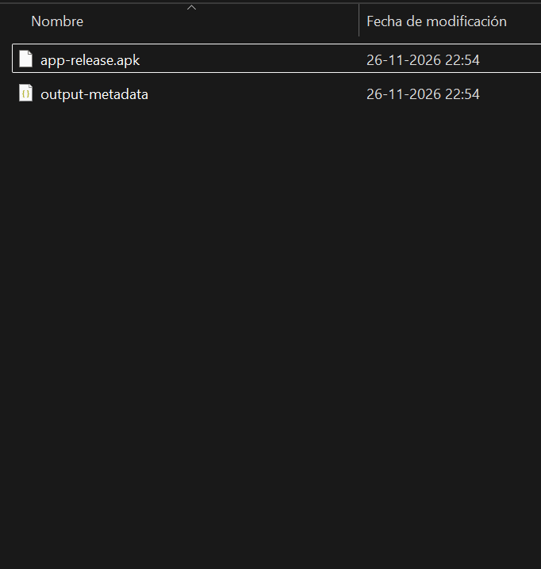
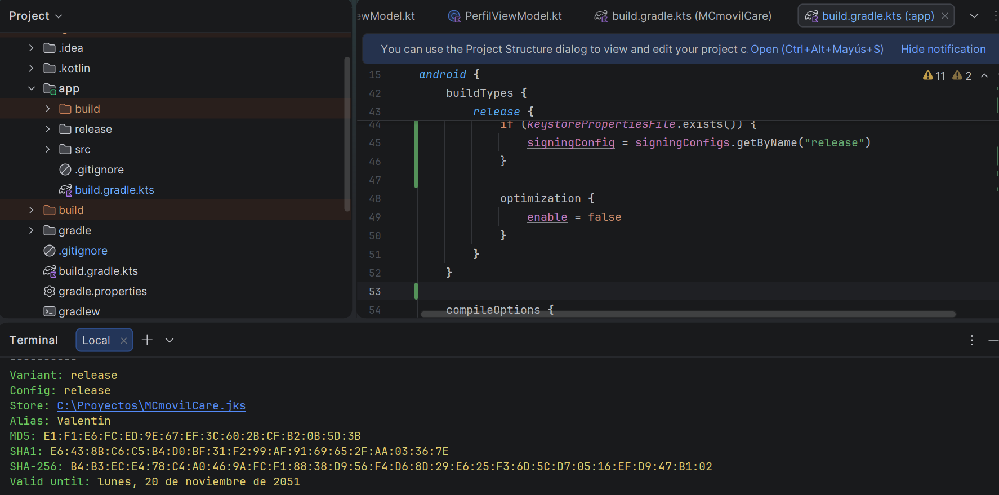
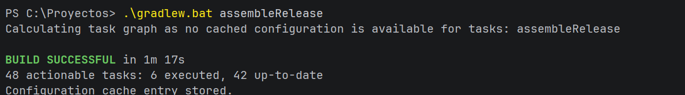

# MCmovil Care — Seguimiento móvil del ciclo de vida de equipos

**Desarrollo de Aplicaciones Móviles (DSY1105) · Evaluación Parcial 4 · Duoc UC, sede Alameda**

MCmovil Care es una aplicación Android que desarrollamos durante el semestre a partir del caso de MCmovil SpA, una empresa dedicada al soporte, la reparación y el mantenimiento de equipos tecnológicos. Nuestro objetivo es que el cliente pueda consultar el estado de sus equipos, revisar sus atenciones y gestionar nuevas solicitudes desde un mismo lugar, sin tener que recurrir a distintos canales de comunicación.

En esta entrega incorporamos la comunicación con nuestro backend REST, el CRUD de solicitudes, la consulta de guías de reparación mediante una API externa, las pruebas y la generación de un APK firmado. Trabajamos exclusivamente con datos ficticios, ya que se trata de un MVP académico y no de una integración con el sistema productivo Gestioo.

## Integrantes — Grupo 6

- Lucas Sepúlveda
- Valentín Salfate

## Link a Trello
- https://trello.com/b/DbPyzi25/appmcmovilcaregrupo6

## Dependencias para correr API
- Visual studio code
- Node.js 18 o superior
- Express

## Pasos a ejecutar

- node -v
- npm -v
- npm ci
- node --check server.js
- npm start

## Funcionalidades de la aplicación

- Registro e inicio de sesión con validación de los datos ingresados y conservación de la sesión al cerrar la aplicación.
- Navegación entre las secciones Equipos, Solicitudes y Perfil mediante Jetpack Compose.
- Consulta de equipos, detalle de órdenes de trabajo, estados, garantías e historial de mantenciones.
- Aprobación y rechazo de cotizaciones, con un motivo obligatorio al rechazar.
- Creación, consulta, edición, cancelación y eliminación de solicitudes de atención.
- Personalización del perfil con fotografías desde la cámara o la galería, guardadas de forma local por usuario.
- Notificaciones locales relacionadas con las solicitudes y las respuestas a cotizaciones.
- Búsqueda de guías de reparación de iFixit según la marca y el modelo del equipo, con acceso al contenido original.

## Arquitectura y organización del proyecto

Desde las primeras entregas utilizamos MVVM para separar la interfaz gráfica, la lógica de la aplicación y el acceso a los datos. Mantuvimos esta estructura al incorporar Retrofit y las nuevas funcionalidades para que el código siguiera siendo fácil de organizar y mantener.

```text
app/src/main/java/com/example/mcmovilcare/
├── model/          Modelos y estados de los formularios
├── data/           Persistencia local y acceso remoto
│   └── remote/     Servicios Retrofit y modelos de respuesta
├── repository/     Acceso a los datos y operaciones REST
├── viewmodels/     Lógica, validaciones y estados
├── navigation/     Rutas y eventos de navegación
├── screens/        Pantallas y componentes de Jetpack Compose
├── ui/theme/       Tema y estilos de la aplicación
└── utils/          Utilidades de imágenes, fechas y notificaciones
```

Las pantallas reciben las acciones del usuario y las envían a los ViewModels. Estos validan la información y utilizan los Repository para consultar o modificar los datos. Los cambios de estado se exponen mediante StateFlow, lo que permite que Jetpack Compose actualice la interfaz según el resultado de cada operación.

Para la comunicación con nuestro servidor utilizamos `RetrofitInstance.kt`, donde se configura la URL base, y `ApiService.kt`, donde se declaran los endpoints. La API externa cuenta con su propia instancia, `RetrofitIfixit.kt`, y su propio servicio, `IfixitService.kt`.

## Backend y persistencia de datos

Desarrollamos nuestro backend con Node.js y Express, utilizando un archivo JSON como almacenamiento de prueba. Elegimos esta alternativa para trabajar con una API REST funcional y concentrarnos en la integración con Android, de acuerdo con la flexibilidad tecnológica indicada por el docente.

El archivo `data/db.json` del servidor conserva los usuarios, equipos, órdenes, solicitudes, mantenciones y sesiones. Las rutas protegidas utilizan un token de autenticación que Retrofit envía mediante el encabezado `Authorization: Bearer <token>`. El servidor valida la sesión, la propiedad de los recursos y las reglas de negocio antes de realizar las operaciones. Las contraseñas se almacenan mediante hash.

En Android seguimos utilizando DataStore Preferences para conservar los datos de sesión, el token y la referencia a la fotografía de perfil. Las fotografías se guardan en el almacenamiento interno de la aplicación. Las solicitudes y las respuestas a cotizaciones, en cambio, se guardan en nuestro servidor para que los cambios persistan al cerrar y volver a abrir la aplicación.

## API REST propia

La API funciona en el puerto 3000. Desde el computador podemos comprobar su disponibilidad en `http://localhost:3000/api/salud`.

Estos son los endpoints que utilizamos para la comunicación entre la aplicación y nuestro servidor, junto con la ruta de comprobación del backend:

| Método | Endpoint | Función |
| --- | --- | --- |
| GET | `/api/salud` | Comprobar que el servidor está activo. |
| POST | `/api/auth/login` | Iniciar sesión y obtener el token. |
| POST | `/api/usuarios` | Registrar un usuario. |
| GET | `/api/equipos` | Consultar los equipos del cliente. |
| GET | `/api/ordenes` | Consultar las órdenes de trabajo. |
| GET | `/api/mantenciones` | Consultar las mantenciones. |
| PATCH | `/api/ordenes/{id}/autorizacion` | Aprobar o rechazar una cotización. |
| GET | `/api/solicitudes` | Consultar las solicitudes de atención. |
| POST | `/api/solicitudes` | Crear una solicitud. |
| PUT | `/api/solicitudes/{id}` | Editar una solicitud existente. |
| PATCH | `/api/solicitudes/{id}/estado` | Actualizar el estado de una solicitud. |
| DELETE | `/api/solicitudes/{id}` | Eliminar una solicitud. |

### CRUD de solicitudes

Una de las funcionalidades que completamos en esta entrega fue la edición de solicitudes. Reutilizamos el formulario de creación para cargar los datos de una solicitud existente y actualizarla sin generar un registro duplicado. De esta forma, podemos demostrar las cuatro operaciones CRUD desde la interfaz de la aplicación.

Una solicitud nueva nace en estado Enviada. Mientras permanezca en ese estado, el cliente puede editarla o cancelarla. La eliminación está disponible para solicitudes enviadas o canceladas. El formulario valida el equipo, el tipo de servicio, la prioridad y una descripción de entre 10 y 300 caracteres. También mantenemos la restricción de que las cotizaciones solo pueden responderse una vez y que su rechazo requiere un motivo de al menos 10 caracteres.

## API externa: iFixit

Escogimos iFixit porque su contenido está directamente relacionado con el caso de reparación y mantenimiento de equipos. Desde el detalle de un equipo, el cliente puede buscar guías de reparación relacionadas con su marca y modelo.

- Base URL: `https://www.ifixit.com/api/2.0/`
- Endpoint: `GET /suggest/{consulta}?doctypes=guide`
- Ejemplo: [Búsqueda de guías para Galaxy A54](https://www.ifixit.com/api/2.0/suggest/Galaxy%20A54?doctypes=guide).

La consulta se realiza con Retrofit y una estructura independiente de nuestro backend. Mostramos hasta cinco resultados con sus títulos, la atribución a iFixit y un enlace hacia la guía original. Si no hay resultados o la consulta falla, mostramos un mensaje sin interrumpir el funcionamiento de las demás pantallas.

Enviamos únicamente información de catálogo del equipo (marca y modelo), sin compartir datos personales, números de serie ni tokens de nuestra API. Las guías son referencias informativas y no reemplazan el diagnóstico del servicio técnico.

El contenido pertenece a sus respectivos autores y se consulta desde iFixit de acuerdo con sus [condiciones de uso](https://www.ifixit.com/Info/Terms_of_Use) y [licencia de contenido](https://www.ifixit.com/Info/Licensing). La [documentación de la API](https://www.ifixit.com/api-docs) contiene las condiciones de acceso vigentes.

## Ejecución del proyecto

Para ejecutar el proyecto contamos con Android Studio, el SDK configurado para la aplicación (SDK 37 y Android mínimo API 24), Node.js 18 o superior y npm.

### 1. Iniciar el servidor

El backend se encuentra en el proyecto `mcmovilcare-api`. Desde la carpeta que contiene `package.json` y `server.js` ejecutamos:

```powershell
npm install
npm start
```

La instalación de dependencias solo es necesaria cuando todavía no están disponibles. El servidor permanece activo mientras utilizamos la aplicación. Podemos comprobarlo desde el navegador del computador en `http://localhost:3000/api/salud`.

### 2. Conectar la aplicación con el backend

Durante las pruebas utilizamos un celular Android físico conectado por USB. La configuración de `RetrofitInstance.kt` en la versión comprobada es la siguiente:

```kotlin
private const val USAR_EMULADOR = false
private const val HOST_PC = "localhost"
```

Con la depuración USB habilitada, utilizamos ADB para permitir que el celular acceda al puerto 3000 del computador. En Windows, desde la raíz del proyecto o cualquier terminal PowerShell:

```powershell
$adb = "$env:LOCALAPPDATA\Android\Sdk\platform-tools\adb.exe"
& $adb devices
& $adb reverse tcp:3000 tcp:3000
```

Si el SDK está instalado en otra ubicación, se utiliza la ruta correspondiente a `platform-tools`. La conexión inversa puede necesitar restablecerse al desconectar el dispositivo.

También es posible configurar el proyecto para un emulador utilizando `USAR_EMULADOR = true`, o utilizar la IP local del servidor como `HOST_PC` cuando el celular y el computador están en la misma red y el puerto 3000 está accesible.

### 3. Ejecutar desde Android Studio

Abrimos la carpeta raíz del proyecto, sincronizamos Gradle, seleccionamos el dispositivo y ejecutamos la aplicación con Run. Para demostrar todas las funcionalidades utilizamos una cuenta ficticia que tenga equipos asignados. El celular necesita acceso a Internet para realizar las consultas de iFixit.

## Pruebas y resultados

Incorporamos pruebas unitarias con Kotest, JUnit, MockK y Coroutines Test, además de pruebas instrumentadas de Jetpack Compose. Trabajamos con repositorios simulados para verificar la lógica de los ViewModels y los Repository, incluyendo autenticación, validaciones de formularios, persistencia y operaciones con los datos.

En esta etapa también agregamos casos de prueba para la edición de solicitudes y el filtrado de las respuestas de iFixit. Las pruebas locales e instrumentadas pueden ejecutarse desde la raíz del proyecto con los siguientes comandos:

```powershell
.\gradlew.bat testDebugUnitTest
.\gradlew.bat connectedDebugAndroidTest
```

La segunda tarea requiere un dispositivo conectado o un emulador activo. La meta de cobertura indicada por el docente para esta evaluación es del 60% de la lógica del proyecto.

Durante el desarrollo obtuvimos resultados satisfactorios en las pruebas automatizadas ejecutadas por el equipo antes de los últimos complementos. Después de integrar las nuevas funcionalidades realizamos 15 comprobaciones funcionales en un celular físico y todas resultaron satisfactorias. Además, instalamos el APK release firmado y verificamos su funcionamiento sin depender del botón Run de Android Studio.

| Comprobación funcional | Resultado |
| --- | --- |
| Inicio de sesión y acceso a los datos | Correcto |
| Consulta de equipos, órdenes y garantías | Correcto |
| Creación, edición, cancelación y eliminación de solicitudes | Correcto |
| Persistencia de los cambios al volver a abrir la aplicación | Correcto |
| Consulta de iFixit y apertura de guías | Correcto |
| Manejo de falta de conexión a la API externa | Correcto |
| Instalación y funcionamiento del APK firmado en el celular | Correcto |

<!-- Evidencia adicional: informe de tests y cobertura de la versión definitiva. -->

## Generación y firma del APK

Para finalizar esta entrega generamos una llave de firma académica llamada `MCmovilCare.jks` y configuramos la variante release en `app/build.gradle.kts`. Asociamos `signingConfigs` con `buildTypes.release` y dejamos los datos privados de la firma en un archivo local `keystore.properties`.

Este archivo contiene las propiedades `storeFile`, `storePassword`, `keyAlias` y `keyPassword`. No forma parte del repositorio público. También excluimos los archivos `.jks` y `.keystore` mediante `.gitignore` para proteger la llave y las credenciales.

Una vez configurada la firma, verificamos el certificado y generamos el APK con Gradle:

```powershell
.\gradlew.bat signingReport
.\gradlew.bat assembleRelease
```

La compilación terminó con `BUILD SUCCESSFUL`, y el informe de firma reconoció la variante release, el almacén de claves y las huellas del certificado. El ejecutable definitivo se genera en `app/build/outputs/apk/release/app-release.apk`.

Después instalamos el APK firmado directamente en un celular Android y comprobamos que la aplicación funcionara correctamente. Aunque el APK puede instalarse sin Android Studio, nuestra versión académica necesita el backend Node.js activo y la conexión USB mediante ADB descrita anteriormente, además de Internet para consultar iFixit.

La llave académica se conserva por separado para futuras versiones del proyecto y para su entrega por el canal privado que indique el docente. No compartimos contraseñas de firma en el código ni en el README.

### Evidencias de generación y firma

**Archivo APK generado mediante Android Studio:**



**Configuración de firma release y resultado de signingReport:**



**Compilación definitiva con Gradle:**



<!-- Evidencia adicional: fotografía o captura de la aplicación release ejecutándose en el celular. -->

## Trabajo en equipo

Durante el semestre utilizamos GitHub para mantener el historial de los cambios realizados por ambos integrantes y Trello para distribuir las tareas, organizar las funcionalidades pendientes y registrar los avances de cada entrega. Ambas herramientas se mantuvieron actualizadas durante el desarrollo de esta parcial.

<!-- Evidencia adicional: enlace de acceso al tablero de Trello, captura de la planificación y enlace al repositorio del backend si está separado. -->

## Tecnologías utilizadas

Kotlin 2.2.10, Jetpack Compose (Material 3), Navigation Compose, ViewModel, StateFlow, DataStore Preferences, corrutinas, Retrofit 2.11.0, Gson, Node.js, Express, JSON, Gradle 9.6 y Android Gradle Plugin 9.4.1. Para las pruebas utilizamos Kotest, JUnit, MockK y Compose UI Test, y para la organización del trabajo utilizamos GitHub y Trello.

## Alcance de esta entrega

Con esta parcial conseguimos integrar la aplicación móvil con nuestro backend, completar el flujo de solicitudes, incorporar una API externa relacionada con el caso y generar un APK firmado que pudimos instalar y utilizar en un dispositivo real.

El MVP está orientado principalmente a la experiencia del cliente. Aunque el backend contempla también los perfiles técnico y administrador, sus interfaces diferenciadas quedan fuera de las funcionalidades completas de esta versión. La integración con Gestioo productivo tampoco forma parte del alcance académico.
